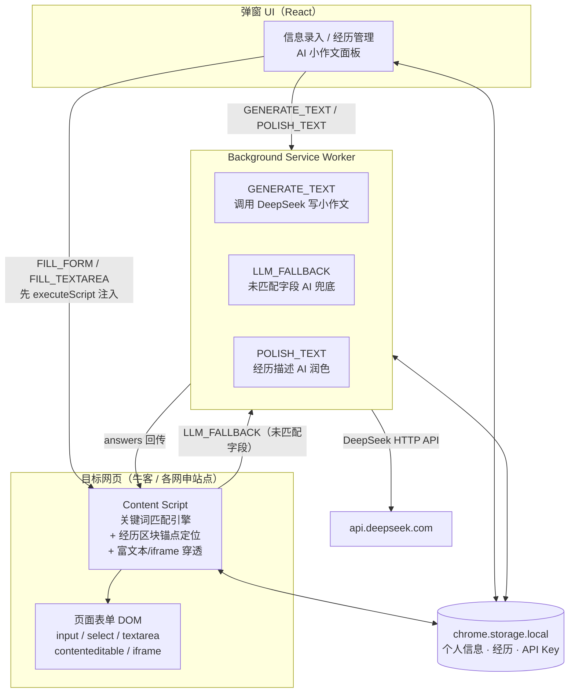
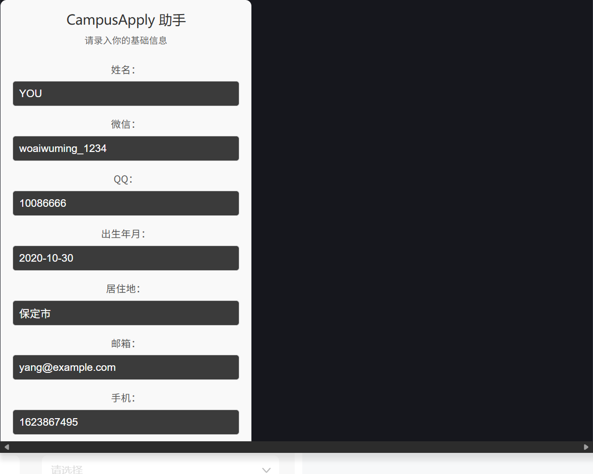
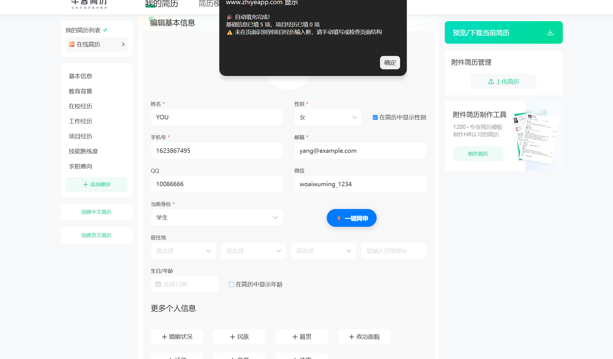
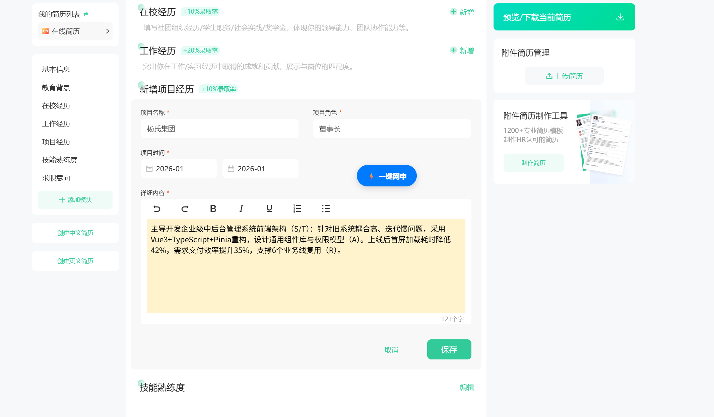

# CampusApply-Agent · 校招网申自动填充助手

> 一键把你的个人信息和项目经历填进各大招聘网站 / 网申系统，还能让 AI 帮你写自我介绍小作文——基于 DeepSeek 大模型的浏览器扩展（Chrome / Edge）。

秋招季填网申，同一段"项目经历"要在十几个网站里复制粘贴几十遍？这个插件就是为此而生：**填一次资料，到处一键填充**。

## ✨ 功能特性

| 功能 | 说明 |
|------|------|
| ⚡ 一键填充基础信息 | 姓名、邮箱、手机、学校、学历、专业、微信、QQ、出生年月、居住地——关键词 + 标签上下文双重匹配，input / select 下拉框通吃 |
| 📋 项目经历智能填充 | 以"项目名称"输入框为锚点定位经历区块，逐段配对填充名称 / 担任角色 / 项目描述，多段经历不串位 |
| 📝 富文本编辑器穿透 | 支持 contenteditable 富文本（Quill / UEditor 等）、**同源 iframe、Shadow DOM** 内的编辑器，用 `execCommand` 模拟真实键盘输入，编辑器内部状态不会丢失内容 |
| ✨ AI 写网申小作文 | 输入题目（如"请介绍你的优势"），DeepSeek 自动生成并直接填入页面文本域 |
| 🤖 AI 智能兜底 | 字典匹配不上的字段自动交给大模型推断（如邮箱推 QQ），**不确定就不填**，绝不污染表单 |
| 🖱️ 悬浮快捷按钮 | 页面右下角"⚡ 一键网申"悬浮球，支持拖拽到顺手的位置 |
| 🔒 隐私安全 | 所有个人信息与 API Key 仅保存在浏览器本地（`chrome.storage.local`），不上传、不进仓库 |

## 🛠️ 技术栈

- **浏览器扩展**：Chrome Extension Manifest V3（Service Worker / Content Script / Popup 三层架构）
- **前端**：React 18 + TypeScript + Vite
- **AI**：DeepSeek Chat API（`deepseek-chat`，`json_object` 强结构化输出）
- **核心 API**：`chrome.scripting.executeScript`（主动注入）、`chrome.runtime.sendMessage`（消息总线）、`chrome.storage.local`（本地持久化）

## 🏗️ 架构图



一次"一键网申"的完整链路：弹窗发送 `FILL_FORM` → content script 注入 → 从本地存储读取资料 → 经历区块锚点填充 + 字典匹配基础字段 → 未匹配字段交 AI 兜底（不确定跳过）→ 汇总反馈。

## 🚀 安装方法

### 从源码构建（推荐）

```bash
git clone https://github.com/ai-code-Yang/recruit-form-auto-fill.git
cd recruit-form-auto-fill
npm install
npm run build        # 产物输出到 dist/
```

然后加载扩展：

1. 打开 `edge://extensions/`（Chrome 为 `chrome://extensions/`）
2. 右上角打开 **开发人员模式**
3. 点击 **加载解压缩的扩展** → 选择项目的 **`dist/`** 目录（注意不是项目根目录）
4. 点工具栏拼图图标，把 CampusApply-Agent **固定** 到工具栏

### 配置

- **个人信息**：点扩展图标 → 录入姓名 / 邮箱 / 学校等 → 保存（存浏览器本地）
- **API Key**：弹窗底部输入你的 [DeepSeek 开放平台](https://platform.deepseek.com) API Key → 保存
  > ⚠️ Key 仅保存在 `chrome.storage.local`，**请勿写死到代码或提交到仓库**
- **本地测试页**：如需在 `file://` 页面测试，请到扩展详情页打开 **"允许访问文件网址"**

## 📸 截图

| 弹窗信息录入 | 项目经历填充（锚点定位 + 富文本） | 基础信息一键填充 |
|:---:|:---:|:---:|
|  |  |  |

> 截图中的示例数据均为虚构。本项目为个人学习开发的开源工具，演示截图涉及的第三方网站界面仅用于功能说明，与牛客官方无任何关联。

## 📁 目录结构

```
├── public/               # 扩展静态文件（构建时原样复制到 dist）
│   ├── manifest.json      # MV3 清单
│   ├── background.js      # Service Worker：DeepSeek 调用 / AI 兜底
│   └── content.js         # 内容脚本：填充引擎（匹配 / 锚点 / 穿透）
├── src/                   # 弹窗 UI（React）
│   ├── App.tsx
│   └── main.tsx
└── dist/                  # 构建产物（加载扩展时选这个）
```

## ⚠️ 免责声明

本插件仅用于**自动化填写你本人自愿提交的表单信息**，请勿用于批量注册、虚假信息填写等违反目标网站服务条款的用途。使用即代表你自行承担相应责任。

## License

MIT
